# UI polish, October 2026

Moon's first polished version, plus a matching System app. Branches:
`ui-polish` in this repository and `ui-polish` in
[a26-system](https://github.com/Yeyito777/a26-system). The browser
(vimbrowser) is unchanged.

All "after" captures come from the real Moon and System binaries running on a
1080x2340 Xvfb display (`scripts/a26-shell/preview.sh`) with simulated
battery/Wi-Fi state and a stand-in Wi-Fi backend. `before-lock-device.png` was
captured from the phone; the other "before" images come from the `main` build
on the same Xvfb display. Images are at half resolution.

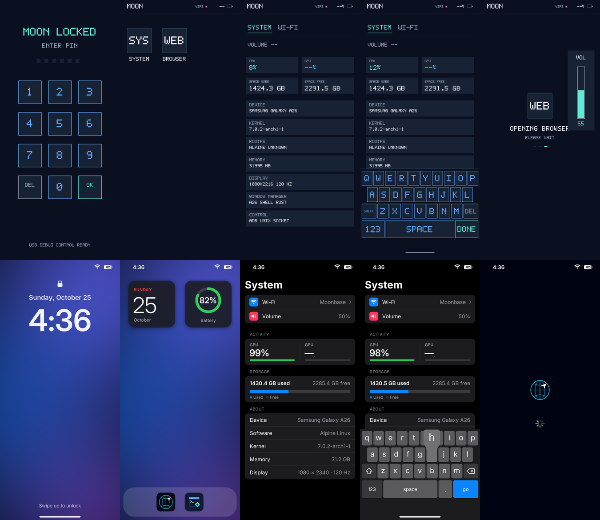

| | Before | After |
|---|---|---|
| Lock | 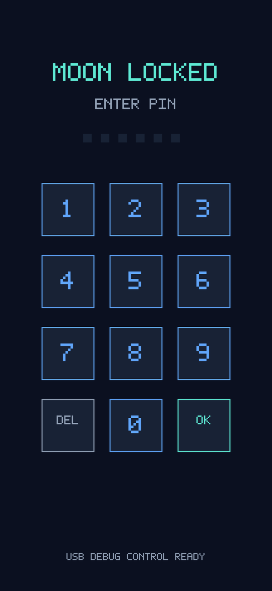 | 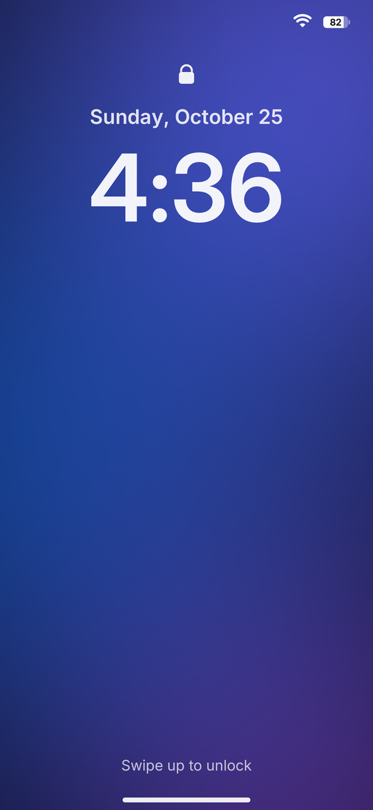 |
| Passcode | (same as lock) | 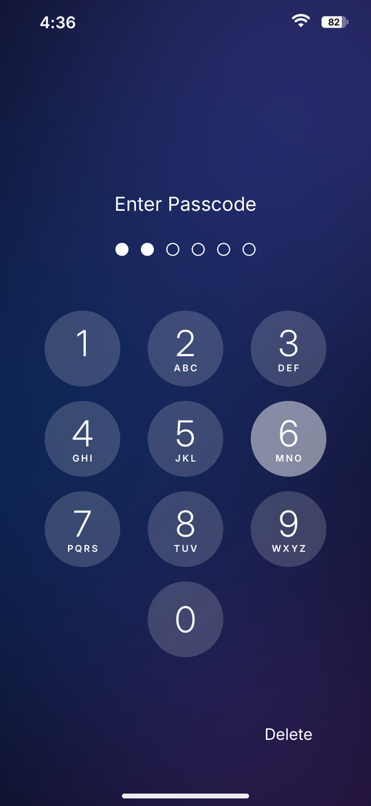 |
| Home | 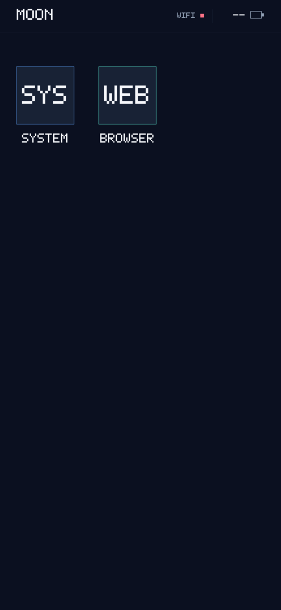 | 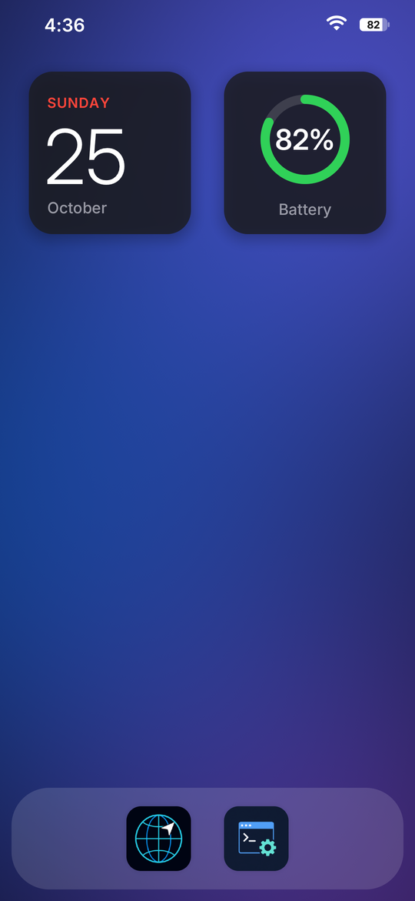 |
| System | 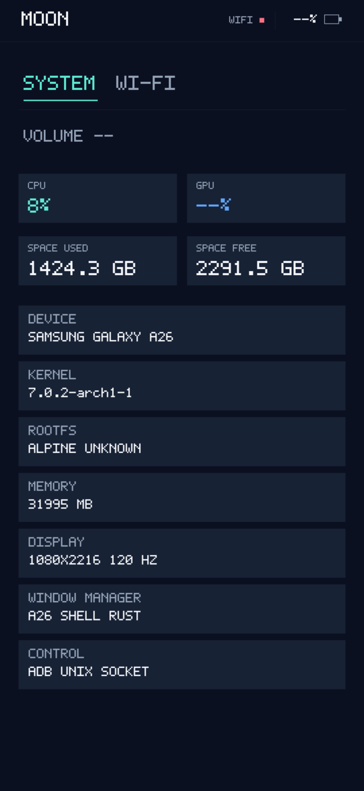 | 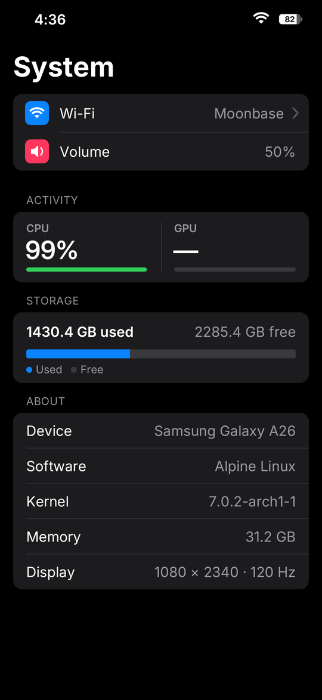 |
| Keyboard | 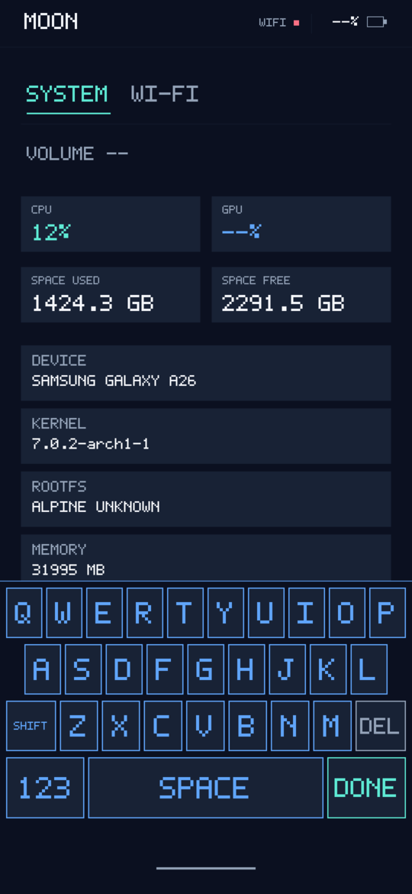 | 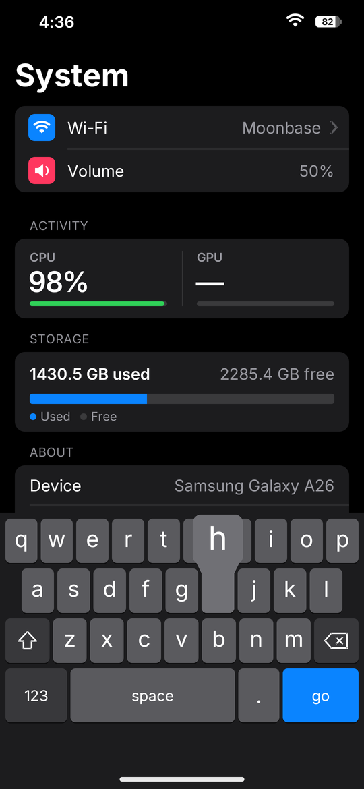 |
| Volume | 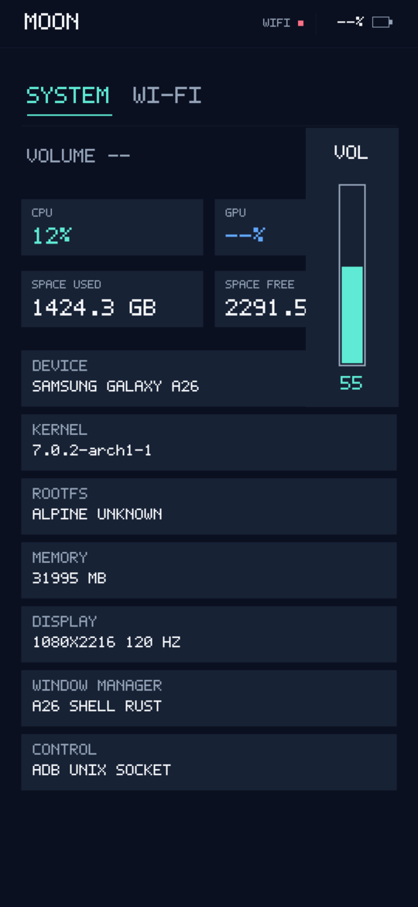 | 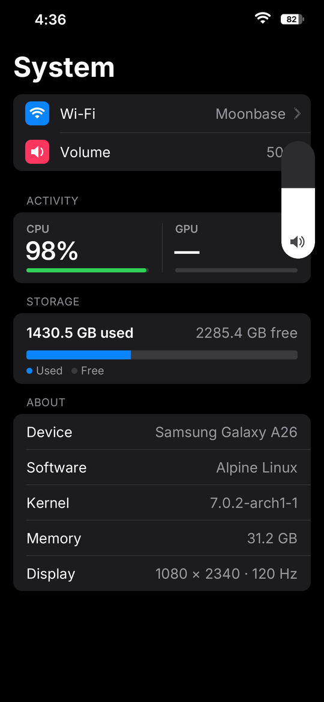 |
| Browser launch | 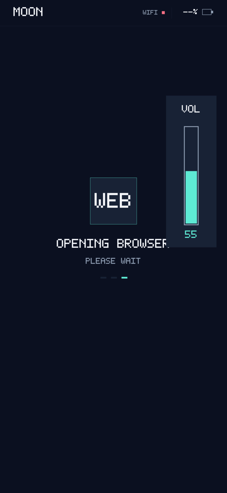 |  |

More captures: `after-open.png` and `after-close.png` (mid-animation frames),
`after-wifi.png`, `after-password.png`, and `after-lock-charging.png`.

## Design direction

- **The iPhone reference, scaled.** Geometry follows the 390-pt iPhone
  portrait reference at ~2.77 px/pt: 60-pt icons with continuous-looking
  corners, 78-pt passcode keys, 44-pt list rows, and 17/12-pt type.
- **One palette.** The iOS dark-appearance system colors (`#000`, `#1C1C1E`
  cells, `#0A84FF` blue, `#30D158` green, `#FF453A` red, 60% secondary
  labels) are used by Moon, its keyboard, and the System app.
- **Real typography.** The embedded Inter typeface, under the SIL OFL 1.1
  (`src/a26-shell/assets/fonts/OFL.txt`; subset to Latin, ~16 KB per weight),
  replaces the 5x7 bitmap font. The Display cut is used for large numerals.
- **Wallpaper.** A procedural night-sky gradient with soft indigo, blue, and
  violet glows, dithered against banding. No image asset is needed.

## What changed and why

### Rendering (Moon)
- New `gfx.rs`: a client-side XRGB rasterizer with analytically anti-aliased
  rounded rectangles, circles, rings, and soft shadows, an exact-coverage path
  filler for glyphs (Wi-Fi, battery, shift, delete, padlock), and bilinear
  image scaling. New `text.rs`: Inter via `fontdue`, with cached glyphs.
- New `present.rs`: each surface keeps a server-side pixmap mirror and uploads
  only the 64-pixel chunks that changed since its last frame, then copies the
  damage to the window. Every request is one-way, so the runtime round-trip
  guard still passes. A moving zoom edge costs only the edge, not the area it
  encloses.
- The shell window has no background, so restacking and unmapping an app never
  flashes a solid fill before Moon repaints.

### Lock screen and passcode
- The lock screen now has a clock face: padlock, date, a large clock, a
  "% Charged" line while charging, a "Swipe up to unlock" hint, and the home
  indicator. Its status bar omits the time, as iOS does.
- Tapping, swiping up, or typing a digit over IPC reveals the passcode keypad:
  dimmed wallpaper, "Enter Passcode", one dot per configured PIN digit,
  circular keys with letters, and a Cancel/Delete corner control that swaps
  as on iPhone.
- Keys highlight on touch-down. A wrong passcode shakes the dots. During the
  existing 30-second lockout the title counts down each second and the keys
  dim. A swipe down, or 12 s of inactivity, returns to the clock and clears
  the entry.
- The old OK key and the "USB DEBUG CONTROL READY" footer are gone. Six digits
  still submit automatically, and the IPC `submit`/`digit`/`backspace`
  commands work unchanged.

### Home screen
- Calendar and battery widgets (the battery ring turns red at 20% or below
  and the caption reads "Charging" while charging), plus a frosted dock
  holding Browser and System.
  *Decision:* with only two apps, the dock puts them where the thumb rests and
  the widgets give the screen something useful to show.
- App icons use the apps' own artwork, masked by Moon to one rounded-square
  silhouette with a soft shadow. Icons dim while pressed.

### App transitions
- **Opening** zooms a rounded card from the icon to fullscreen (340 ms
  ease-out). The card's color is sampled from the icon's own background, so
  the artwork appears to grow out of itself. The window is revealed when the
  zoom ends and the app has painted. Slow starts (the Browser) keep a centered
  launch screen with an iOS-style activity indicator. The old "OPENING BROWSER
  / PLEASE WAIT" text and dots are gone.
- **Closing** (swipe up, or an app exiting) zooms the card back into its dock
  icon (300 ms) and crossfades into the icon.
- **Resuming** a background app plays the same opening zoom over the
  preserved window, which is then raised.
- **New:** a horizontal swipe along the bottom edge switches straight to the
  other app.
- **Fix:** a new app window is created at the top of the stack, and Moon used
  to map it before putting the launch screen back on top, so cold launches
  could flash a half-painted window. Moon now restacks before mapping.
  ConfigureRequests during a launch no longer raise the app.
- The System app now also goes through the launch screen (briefly), so it
  never appears half-drawn.

### Status bar
- The time sits in the left ear, and Wi-Fi (three bands, dimmed when
  disconnected) and an iOS-style battery sit in the right ear: the level fill
  is green while charging and red at 20% or below, with the percentage drawn
  inside the glyph. A bolt shows while charging.
- Over apps the strip is black, so the camera notch disappears into it. The
  "MOON" wordmark is gone.

### Keyboard
- iOS dark keyboard: gray letter keys and darker function keys with a 1-pt
  shadow, lowercase labels until Shift, outline/filled shift arrows, a delete
  glyph, `space`, and `return` for text. `go`, `search`, and `done` keys are
  blue.
- **New:** an enlarged key callout appears above a held character key, in a
  shaped override-redirect window so top-row callouts can rise over the app.
- The home indicator sits in the key-free bottom zone where the global swipe
  starts.
- Behavior is unchanged: geometry, hit testing, repeat, rollover, and XTEST
  injection are untouched, and all keyboard tests still pass.

### Volume HUD
- A capsule beside the A26's right-edge volume rocker that fills from the
  bottom, with a speaker glyph whose waves follow the level. Over apps it is
  a SHAPE-extension window, so the app stays visible around it.

### System app (a26-system, `ui-polish` branch)
- An iOS Settings-style app with a large title:
  - Wi-Fi row (showing the current network) and Volume row;
  - CPU/GPU meters, a storage bar, and an About list.
- The Wi-Fi page is pushed with a "‹ System" back button and shows:
  - the current network with a checkmark and IP address, and a red Disconnect
    row;
  - a network list with lock and signal glyphs (7 per page);
  - inline status messages in sentence case.
- **Behavior:** password entry now uses **Moon's system keyboard**, so the
  phone has a single keyboard. The app decodes the XTEST key presses on its
  window. Return joins, and an invalid password re-opens the keyboard. The old
  in-app keyboard is kept only as a fallback if Moon refuses.
- **Efficiency:** the event loop now blocks in `poll(2)` instead of waking
  every 16 ms. It wakes every 125 ms only while Wi-Fi work is in flight.
- The System page asks for Wi-Fi status at startup, so its Wi-Fi row is
  accurate before the page is opened. Memory is shown as "7.2 GB".

### Developer tooling
- `scripts/a26-shell/preview.sh` runs Moon on Xvfb with simulated status.
  `MOON_PROFILE=1` logs per-frame draw and upload times.
- Moon honors `MOON_STATUS_ROOT` (simulated sysfs) and per-app icon overrides
  (`A26_SYSTEM_ICON`, `A26_BROWSER_ICON`). a26-system honors
  `A26_SHELL_SOCKET` and, for an unprivileged stand-in backend on a
  non-default socket, `A26_WIFI_SOCKET`. The default root-only endpoint still
  requires a UID-0 peer.

## Performance notes

On whale (heavily loaded, load average ~25), a zoom frame costs ~3–6 ms to
draw and ~2–5 ms to upload to Xvfb, and the static screens are only redrawn
on change. The phone is slower and was not measured. To measure, start Moon
once with `MOON_PROFILE=1` in its environment (for example by adding it to the
`env` line in `start.sh`) and read the `frame`/`draw`/`present` lines in
`/root/a26-shell.log` during a few launches. If frames run long, the next
lever is skipping the full-canvas copy and diff outside the animated
rectangle.

Memory: the shell holds a few full-screen buffers (canvas, wallpaper, dimmed
wallpaper, home layer, and the presenter's mirror), about 50 MB.

## Deploy (device lead)

Both branches are pushed to GitHub. Nothing has been deployed or run on the
phone yet. Only read-only `screenshot.sh` and `ctl.sh state` were used.

1. **Moon** (from this repo on the Mac, branch `ui-polish`):
   ```sh
   git checkout ui-polish
   scripts/a26-shell/deploy.sh          # builds, runs device tests, swaps binaries
   ```
   Then restart Moon: `scripts/a26-shell/deploy.sh --reboot`, or use your
   usual Moon restart. **A Moon restart is required.** `config.json` and the
   PIN are untouched.
2. **Clock time zone (recommended).** The Alpine rootfs has no
   `/etc/localtime`, so the new clocks would show UTC. Set a POSIX rule
   before the restart, for example Toronto:
   ```sh
   scripts/a26-shell/set-timezone.sh 'EST5EDT,M3.2.0,M11.1.0'
   ```
   This helper is untested on the device. Alternatively, add
   `"timezone": "EST5EDT,M3.2.0,M11.1.0"` to
   `/data/local/a26-linux/etc/a26-shell/config.json` (root, 0600) by hand.
   `"clock_24h": true` is optional.
3. **System app** (a new install is required). It needs an aarch64 musl
   toolchain; whale has one:
   ```sh
   # on whale, in a checkout of a26-system at branch ui-polish
   scripts/build.sh
   # copy target/aarch64-unknown-linux-musl/release/a26-system to the Mac, then:
   adb -s R5CY323ES7X push a26-system /data/local/tmp/a26-system
   adb -s R5CY323ES7X shell "/data/local/tmp/su -c 'd=/data/local/a26-linux/opt/a26-system/bin; cp /data/local/tmp/a26-system \$d/a26-system.new && chown 0:0 \$d/a26-system.new && chmod 0755 \$d/a26-system.new && mv -f \$d/a26-system.new \$d/a26-system'"
   ```
   Alternatively, run `scripts/install.sh` from a host with the toolchain and
   ADB access. The Wi-Fi service, its packages, and the icon are unchanged.
   Restart Moon (or close System) so the new binary starts.
4. **Browser:** no rebuild needed.

### What to verify on the phone
- Wake shows the clock. Tap, or swipe up, to reach the keypad. A wrong
  passcode shakes, the correct one opens home.
- Opening System and Browser zooms from the dock with no flash of a
  half-drawn window. Swiping up zooms back into the icon. A bottom-edge
  horizontal swipe switches apps.
- The keyboard looks right in the Browser URL bar and in System → Wi-Fi → a
  secured network, and typed characters reach both. The key callout appears
  above the pressed key.
- The volume keys show the capsule HUD over apps. The status bar time is
  local and changes on the minute.
- Animation smoothness: judge by eye, or measure with `MOON_PROFILE=1` as
  described above.

## Verified on the phone (2026-10-25)

Deployed by the device lead with a26-system `main` (this UI merged with the
Enterprise Wi-Fi backend). Captures in [`device/`](device/) are the phone's
own X screen (`screenshot.sh`), driven over IPC, at half resolution:
[lock](device/lock.png), [passcode](device/passcode.png),
[home](device/home.png), [System](device/system.png),
[Wi-Fi](device/wifi.png), [keyboard](device/keyboard.png),
[browser launch](device/browser-launch.png), [browser](device/browser.png),
[volume HUD](device/volume.png).

- Clock: local time (EDT) from `"timezone": "EST5EDT,M3.2.0,M11.1.0"`.
- System shows real values: UofT, volume, CPU/GPU, 15.0 GB used / 208.5 GB
  free, Alpine 3.24.1, kernel, 7.2 GB, 1080 × 2340 at 120 Hz. The Wi-Fi page
  shows UofT connected with its IP. A saved enterprise network is joinable;
  an unsaved one (eduroam) is listed as Unsupported, since the UI has no
  identity field (provision with `a26-wifi-ctl connect-enterprise`).
- Frame timing (`MOON_PROFILE=1`), System open and close zooms, three runs
  each: as shipped, 15–27 ms per frame with spikes to 52 ms; with the
  scheduler boost below, 13–14 ms on average and 16–18 ms at most (one cold
  first open at 40 ms). Drawing is 5–9 ms of that and presenting most of the
  rest.
- Scheduler boost: without the framework nothing boosts the foreground UI,
  so animations ran on slow cores at low clocks. Moon now sets a 60 %
  `uclamp.min` on its own thread with `SCHED_FLAG_RESET_ON_FORK` (apps are
  not boosted; verified on the System app), and the supervisor puts Xorg in
  a `moon-display` cpu group with the same floor. Both apply only while the
  task runs.
- Idle, home screen: Moon 40 ms CPU and 17 wakeups per minute (screen off:
  30 ms, 14), Xorg 10 ms; the whole system 1.4–1.6 % busy, as before. No
  busy loop.
- Memory: Moon RSS 68 MB, Xorg 60 MB; MemAvailable 6.49 GB against 6.57 GB
  with the old UI (about 85 MB more, buffers plus server-side mirrors).
- Direct boot reaches the new Moon with `moon.session.ready` at ≈ 21.3 s.
- Fixed during deployment: `set-timezone.sh` wrote through `adb exec-in`,
  which ran only the first command of its chain (it left a `config.json.new`
  and changed nothing); it now writes through `adb shell`, keeps the PIN
  fields, and checks the result. The battery widget's "100%" was shrunk to
  clear the ring.

## Not done / follow-ups
- Browser chrome: vimbrowser's A26 bottom bar is drawn inside the patched
  Chromium build, which needs an ARM64 CEF rebuild, so it was left as is.
  Moon now frames it consistently: black status strip, launch screen, system
  keyboard, and app switching.
- No notification UI exists yet (TODO 11). The lock screen leaves the space
  for it.
- No interactive (finger-following) close gesture or app-switcher cards.
  Those need app snapshots, which could be done server-side with XRender.
